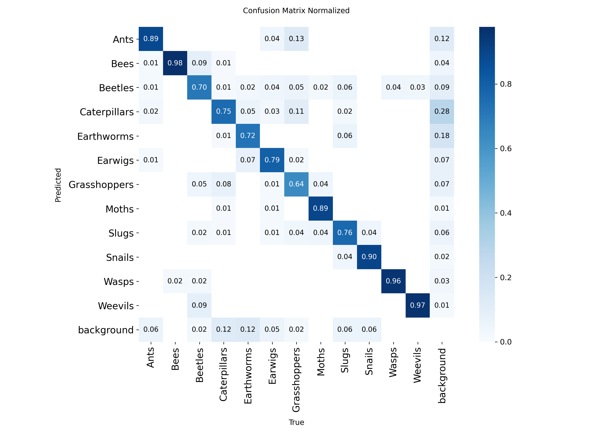
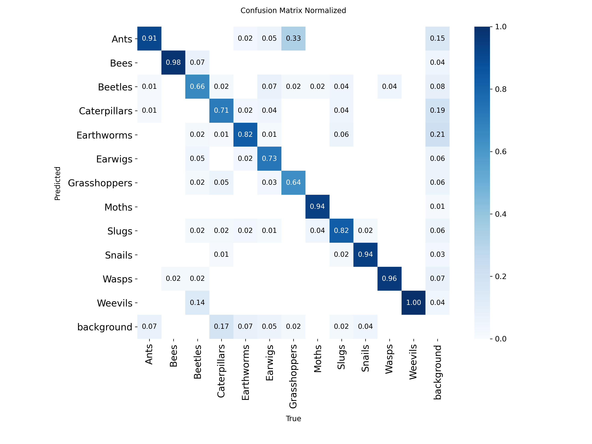
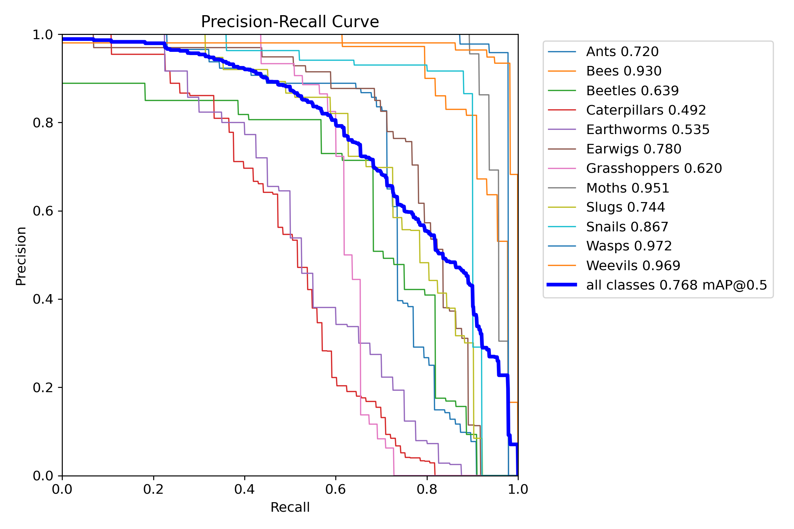
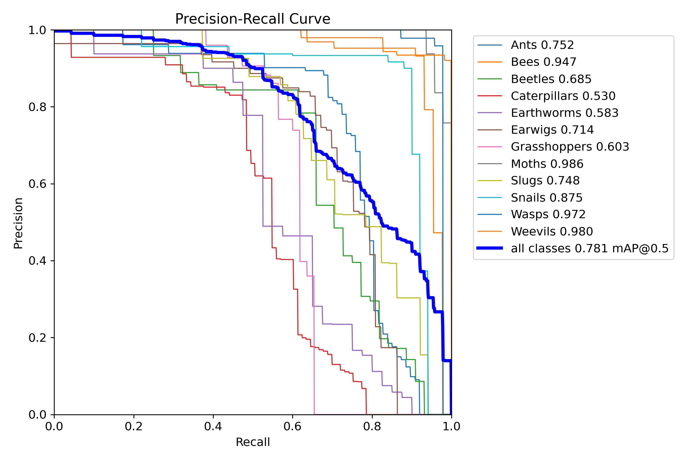
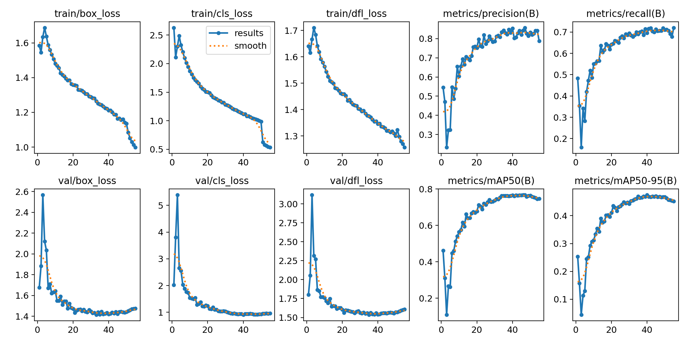
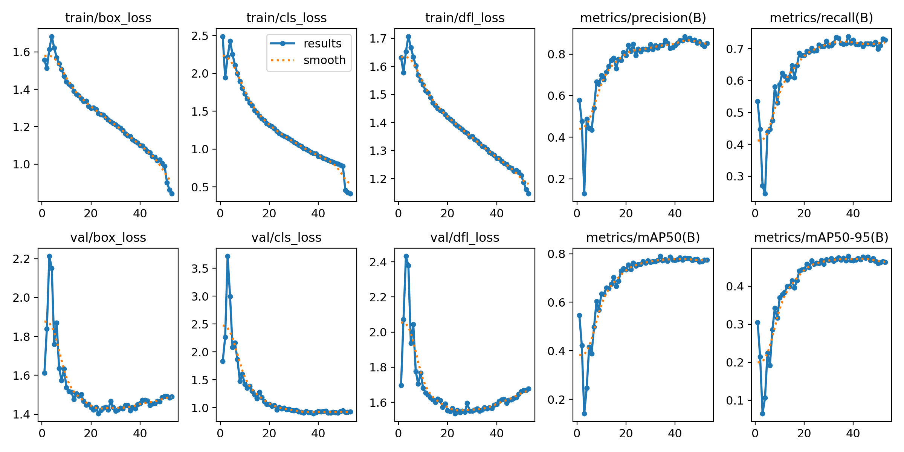

# Böcek ve Omurgasız Tespiti: Düşük Donanım için Hafif Nesne Algılama

   [](https://colab.research.google.com/github/burakbasdere/insect-detection-yolo11/blob/main/demo_colab.ipynb)

**Türkçe** | [English](README_en.md)

YOLO11 ile 12 sınıflı böcek ve omurgasız tespiti. Amaç, **zayıf donanımda (tek CPU çekirdeği, gömülü cihaz, telefon) hızlı çalışan** hafif bir model üretmek ve doğruluk/hız dengesini ölçmektir.

**Sınıflar:** karınca, arı, böcek, tırtıl, solucan, kulağakaçan, çekirge, güve, sümüklüböcek, salyangoz, eşek arısı, kınkanatlı (weevil).

## Özet

- İki model karşılaştırıldı: **YOLO11n** (~2,6 M parametre) ve **YOLO11s**.
- YOLO11s, mAP50'de yaklaşık 1,3 puan daha iyi ama yaklaşık 3 kat yavaş.
- Zayıf donanım hedefi için **YOLO11n** daha uygun: tek CPU çekirdeğinde ~27 FPS, ONNX boyutu ~10,6 MB.

## Hızlı deneme

- Colab: yukarıdaki **Open In Colab** rozeti ile kurulum yapmadan kendi fotoğrafınızda deneyin.
- Yerelde web arayüzü: `pip install -r requirements.txt` ardından `python app.py`.

## Veri seti

| Bölüm | Görüntü | Kutu |
|---|---|---|
| Train | 11.502 (3.847 özgün kaynak, Roboflow augmentasyonu) | 15.282 |
| Valid | 1.095 | 1.341 |
| Test | 546 | 689 |

- Format: YOLO (`class x y w h`, normalize), 12 sınıf.
- Sınıflar dengeli (train'de sınıf başına ~900-2.200 kutu).
- Train/valid/test arasında ortak kaynak görüntü olmadığı kontrol edildi (sızıntı yok).
- Nesneler görüntünün büyük bölümünü kaplıyor (medyan kutu alanı ~%28), bu yüzden düşük çözünürlük (416) yeterli.
- Veri seti bu repoda **yer almaz**; kaynağı Roboflow'dur ve lisansı kaynağındaki koşullara tabidir.

## Yaklaşım

- Modeller Google Colab (T4 GPU) üzerinde eğitildi, giriş boyutu 416x416.
- Dağıtım için ONNX ve INT8 TFLite formatlarına aktarıldı.

## Sonuçlar

| Model | Precision | Recall | mAP50 | mAP50-95 | ONNX (MB) | CPU 1 çekirdek (ms) | FPS |
|---|---|---|---|---|---|---|---|
| YOLO11n | 0.842 | 0.706 | 0.768 | 0.466 | 10.58 | 36.8 | 27.2 |
| YOLO11s | 0.859 | 0.732 | 0.781 | 0.476 | 37.85 | 102.3 | 9.8 |

Hız ölçümü ONNX Runtime ile, tek iş parçacığı ve 416x416 girişle yapılmıştır (zayıf cihaz benzetimi). Gerçek cihaz sonuçları farklı olabilir. Ham değerler: [results_summary.csv](results_summary.csv).

### Grafikler

| | YOLO11n | YOLO11s |
|---|---|---|
| Confusion matrix (normalize) |  |  |
| PR eğrisi |  |  |
| Eğitim eğrileri |  |  |

## Hazır modeller

| Dosya | Açıklama |
|---|---|
| [models/yolo11n.onnx](models/yolo11n.onnx) | YOLO11n, ONNX (~10,6 MB) |
| [models/yolo11n_int8.tflite](models/yolo11n_int8.tflite) | YOLO11n, INT8 TFLite (~3 MB), mobil/gömülü için |

## Kullanım

```bash
pip install -r requirements.txt
yolo predict model=models/yolo11n.onnx source=resim.jpg imgsz=416
```

Python ile:

```python
from ultralytics import YOLO

model = YOLO("models/yolo11n.onnx")
results = model.predict("resim.jpg", imgsz=416)
results[0].show()
```

## Sınırlamalar

- Eğitim görüntüleri tek kaynaktan (Roboflow) geldiği için gerçek dünya koşullarında (farklı ışık, arka plan) doğruluk düşebilir.
- Hız değerleri tek bir CPU benzetimiyle ölçüldü; hedef cihazda ayrıca test edilmelidir.
- 12 sınıf dışındaki canlılar tanınmaz.

## Lisans

Kod ve modeller AGPL-3.0 ([LICENSE](LICENSE)) kapsamındadır. Modeller [Ultralytics YOLO11](https://github.com/ultralytics/ultralytics) ile eğitildi; Ultralytics ve türetilen ağırlıklar AGPL-3.0 lisansı kapsamındadır. Veri seti ayrı lisansa tabidir (Roboflow kaynağına bakın).
