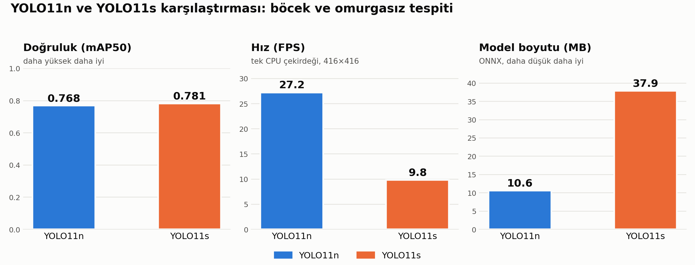
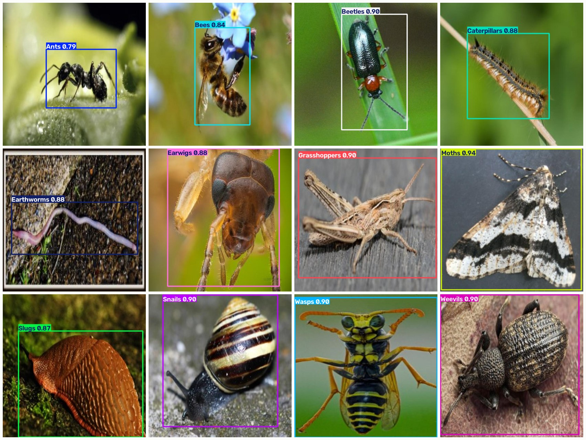

# Insect & Invertebrate Detection: Lightweight Object Detection for Low-End Hardware

   [](https://colab.research.google.com/github/burakbasdere/insect-detection-yolo11/blob/main/demo_colab.ipynb)

[Türkçe](README.md) | **English**

12-class insect and invertebrate detection with YOLO11. The goal is a **lightweight model that runs fast on weak hardware** (a single CPU core, embedded devices, phones) and a measured accuracy/speed trade-off.

**Classes:** ant, bee, beetle, caterpillar, earthworm, earwig, grasshopper, moth, slug, snail, wasp, weevil.

## Summary

- Two models compared: **YOLO11n** (~2.6M parameters) and **YOLO11s**.
- YOLO11s is about 1.3 mAP50 points more accurate but roughly 3x slower.
- For the low-end hardware goal, **YOLO11n** fits best: ~27 FPS on a single CPU core, ~10.6 MB ONNX file.

## Quick try

- **Colab:** click the *Open In Colab* badge above, upload a photo, done.
- **Local web UI:** `pip install -r requirements.txt` then `python app.py`.

## Dataset

| Split | Images | Boxes |
|---|---|---|
| Train | 11,502 (3,847 original sources, Roboflow augmentation) | 15,282 |
| Valid | 1,095 | 1,341 |
| Test | 546 | 689 |

- YOLO format, 12 classes, well balanced (~900-2,200 boxes per class in train).
- Checked for leakage: no shared source images between train/valid/test.
- Objects cover a large part of the image (median box area ~28%), so a low input resolution (416) is sufficient.
- The dataset is **not included** in this repo. It comes from Roboflow and is subject to its own license.

## Approach

- Trained on Google Colab (T4 GPU) at 416x416 input.
- Exported to ONNX and INT8 TFLite for deployment.

## Results



| Model | Precision | Recall | mAP50 | mAP50-95 | ONNX (MB) | CPU 1 core (ms) | FPS |
|---|---|---|---|---|---|---|---|
| YOLO11n | 0.842 | 0.706 | 0.768 | 0.466 | 10.58 | 36.8 | 27.2 |
| YOLO11s | 0.859 | 0.732 | 0.781 | 0.476 | 37.85 | 102.3 | 9.8 |

Speed was measured with ONNX Runtime, single thread, 416x416 input (low-end device simulation). Real device results may differ. Raw values: [results_summary.csv](results_summary.csv).

### Example predictions (detection + classification)

One example per class from the test set: the single-object image the model predicted correctly with the highest confidence (YOLO11n, confidence threshold 0.25). These are **hand-picked best cases**, not representative of average performance; see the metrics above for overall accuracy. Images come from the Roboflow dataset.



### Plots

| | YOLO11n | YOLO11s |
|---|---|---|
| Confusion matrix (normalized) |  |  |
| PR curve |  |  |
| Training curves |  |  |

## Models

| File | Description |
|---|---|
| [models/yolo11n.onnx](models/yolo11n.onnx) | YOLO11n, ONNX (~10.6 MB) |
| [models/yolo11n_int8.tflite](models/yolo11n_int8.tflite) | YOLO11n, INT8 TFLite (~3 MB), for mobile/embedded |

## Usage

```bash
pip install -r requirements.txt
yolo predict model=models/yolo11n.onnx source=image.jpg imgsz=416
```

```python
from ultralytics import YOLO

model = YOLO("models/yolo11n.onnx")
results = model.predict("image.jpg", imgsz=416)
results[0].show()
```

## Limitations

- Training images come from a single source (Roboflow), so accuracy may drop in real-world conditions (different lighting, backgrounds).
- Speed numbers come from a single-CPU simulation; test on your target device.
- Animals outside the 12 classes are not recognized.

## License

Code and models are under AGPL-3.0 ([LICENSE](LICENSE)). The models were trained with [Ultralytics YOLO11](https://github.com/ultralytics/ultralytics). The dataset has its own license (see the Roboflow source).
